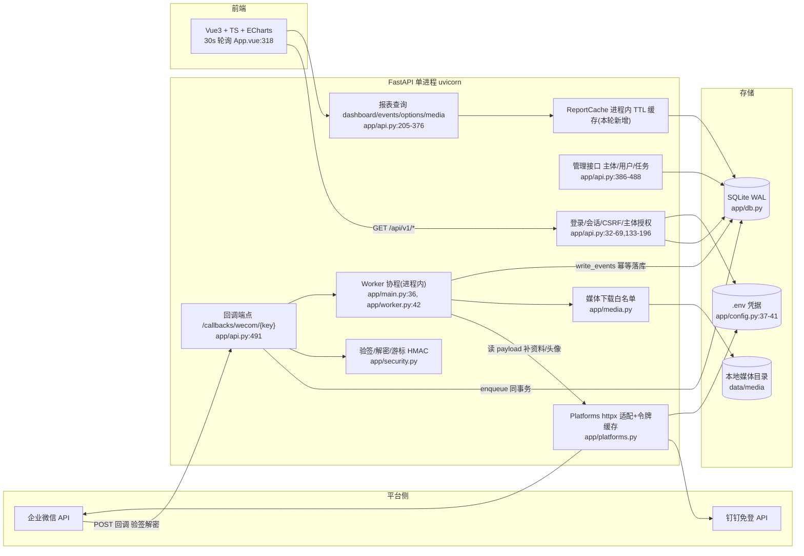

# 性能优化方案:架构分析与分阶段落地

> 生成日期:2026-10-24。基于当前 master 工作区代码逐文件分析。
> 标注约定:**事实(来自代码)** = 直接引用 `文件:行号`;**假设** = 需按给出的命令验证的推断。

---

## 0. 结论(TL;DR)

1. **回调链路的可靠性设计是达标的**(事实):收件箱+任务同事务落库(`app/worker.py:29-32`)、payload 级去重(`app/worker.py:20-23` + 唯一约束 `app/models.py:81`)、租约式任务领取支持崩溃恢复(`app/worker.py:64-74`)、事件写入按 `(tenant_id, callback_id, item_key)` 幂等(`app/models.py:106`)。回调超时重试不会重复计数。
2. **当前最大的性能瓶颈在报表读取侧**(事实):看板单次请求执行 8 个聚合查询(`app/api.py` dashboard 端点),事件列表每翻一页重复一次全范围 count+sum(`app/api.py:314`),而前端每 30 秒轮询一次(`frontend/src/App.vue:318`)。按 1000 并发报表用户计算,是约 33 QPS × 8 次全表聚合的持续负载,且随数据量线性恶化。
3. **本轮已落地 4 个 P0 补丁**(无 schema 变更、可即时回滚):看板 TTL 缓存、翻页 totals 进 HMAC 游标、头像/媒体长缓存、SQLite 读连接池扩容。验证:149 个 pytest 全部通过、ruff 通过。
4. **×10 量级**靠档 A 的 P1 项(预聚合日表、worker 批量并发)即可支撑;**×100 量级**必须引入 PostgreSQL(写并发/分区/备份)与 Redis(跨进程缓存/限流),SQLite 单写者模型是硬上限。
5. worker 是**单任务串行**处理(`app/worker.py:62-74`),500 人群的成员补全单个任务可达 500 次平台 API(`app/worker.py:139-163`),突发回调会积压——这是事件侧的首要扩容点。

---

## 1. 架构分析

### 1.1 模块划分



### 1.2 数据流:企微回调 → 处理 → 存储 → 报表

1. **接入**(`app/api.py:491-531`):按 `callback_key` 找主体 → SHA1 验签 + AES-CBC 解密(`app/security.py:37-61`)→ XML 解析与字段校验 → `enqueue`。
2. **可靠入队**(`app/worker.py:20-39`):payload 规范化 JSON 后取 SHA256 作 `dedupe_key`;收件箱 + Job **同一事务**提交后才返回 `success`(事实,满足仓库约束);并发重复由唯一约束 + `IntegrityError` 兜底。
3. **异步处理**(单 worker,`app/worker.py:42-99`):每 tick 按 `(status, next_run_at)` 领取 1 个任务;乐观 UPDATE 抢占租约(180s,`app/worker.py:70-74`),崩溃后租约过期自动重跑;`normalize` 内 120s 超时;失败按指数退避重试,≥5 次转 `failed`。
4. **资料补全**(`app/worker.py:101-225`):员工/客户/群资料经企微 API 拉取并 5 分钟进程内缓存;头像仅允许腾讯图床 HTTPS 源(`app/media.py:20-26`),2MB 上限、魔数校验、按租户内 SHA256 去重落盘。
5. **事件落库**(`app/worker.py:227-244`):按 `(tenant_id, callback_id, item_key)` upsert,混合群回调拆分为 `group`/`group_other` 记录且总人数守恒(`app/event_classification.py:28-75`);重试重写同键记录,不产生重复。
6. **报表读取**(`app/api.py:205-376`):会话鉴权 + 主体授权过滤 → 看板 8 个聚合 / 事件列表分页 / 选项搜索;媒体按租户隔离校验后 `FileResponse`。
7. **前端轮询**:看板页每 30s 刷新(`frontend/src/App.vue:318`),列表与看板共用同一套业务分类口径(回归测试 `tests/test_customer_group_classification.py:142` 保证一致性)。

### 1.3 技术栈清单(事实)

| 层 | 组件 | 版本/位置 |
|---|---|---|
| 运行时 | Python | 3.12(`pyproject.toml`) |
| Web | FastAPI + uvicorn[standard] | 单进程,`app/main.py:113` |
| ORM/DB | SQLAlchemy 2 async + aiosqlite(SQLite WAL) | `app/db.py` |
| 迁移 | Alembic(含可回放数据迁移) | `migrations/versions/0002` |
| HTTP 客户端 | httpx(超时 10s,禁重定向) | `app/platforms.py:16` |
| 加密 | cryptography(Fernet 载荷加密、AES-CBC 回调解密) | `app/security.py`、`app/worker.py:27` |
| XML | defusedxml | `app/security.py:20` |
| 配置 | pydantic-settings + .env | `app/config.py` |
| 前端 | Vue 3.5 + TypeScript + ECharts 6 + Vite 7 + dingtalk-jsapi | `frontend/package.json` |
| 任务队列 | **自研数据库队列**(processing_jobs 表,租约+退避) | `app/worker.py` |
| 缓存 | 无外部缓存;本轮新增进程内 TTL 缓存 | `app/api.py:ReportCache` |

### 1.4 外部依赖(事实)

- 企业微信 API:`gettoken`、`user/get`、`externalcontact/get`、`externalcontact/groupchat/get`(`app/platforms.py:85-93`),以及头像图床 `*.qpic.cn / *.qlogo.cn`(`app/media.py:20`)。
- 钉钉 API:`oauth2/accessToken`、`getuserinfo`、`user/get`(`app/platforms.py:95-113`)。
- 部署脚本(`deploy/`)面向宝塔/非容器环境;诊断脚本(`scripts/check_wecom.py` 等)访问真实平台。

---

## 2. 瓶颈清单(证据)

### 2.1 报表读取(最高优先级)

| # | 问题 | 证据 | 影响 |
|---|---|---|---|
| B1 | 看板单请求 8 个聚合,全部扫描 business_events:2 次 counts、1 次 30 天趋势(strftime 逐行)、3 次 tops(JSON 聚合)、1 次 unresolved、1 次 pending | `app/api.py:211-243`(本轮前) | 1000 人 30s 轮询 = ~33 QPS × 8 聚合;×100 数据量时单次趋势聚合需扫描数十万行 |
| B2 | 事件列表每页重复全范围 `count()+sum(quantity)` | `app/api.py:314` | 翻 10 页 = 10 次全量聚合;深翻页延迟线性恶化 |
| B3 | 关键词搜索用 `instr(lower(...))` 与 `json_extract`,无法命中索引,过滤集内逐行计算 | `app/api.py:271-279`(员工名三重匹配+关联子查询)、`app/api.py:291-297`(群名) | ×10 后成为最慢查询;O(时间窗内行数) |
| B4 | tops 排行在聚合内对 snapshot JSON 做 `json_extract` | `app/api.py:232-238` | 同上,且占用聚合关键路径 |
| B5 | 选项接口 offset 分页 + `profiles ∪ business_events` union 全量排序 | `app/api.py:346-357` | 数据量大时前端搜索下拉变慢 |
| B6 | 头像/媒体响应强制 `no-store`,每次浏览回源 | `app/main.py:64` + `app/api.py:376`(本轮前) | 群事件行内 3 头像 × 20 行/页 × 1000 人,媒体回源是纯浪费 |

### 2.2 事件处理(worker)

| # | 问题 | 证据 | 影响 |
|---|---|---|---|
| B7 | 每 tick 只领取并处理 1 个任务,单 worker 串行 | `app/worker.py:62-74`、`app/main.py:36` | 吞吐上限 ~数十 job/分钟(假设,见 §6 验证);突发回调积压 |
| B8 | 群成员补全:500 人群 = 500 次平台 API(信号量 3,80s 超时),单个任务可占满整个租约 | `app/worker.py:139-167` | 大群活跃时队列倾斜;租约 180s(`app/worker.py:71`)接近极限 |
| B9 | 每个 profile 读写都独立开关 session 并 commit;`synchronous=FULL` 使每次提交 fsync | `app/worker.py:101-123`、`app/db.py:14` | 500 人群 ≈ 1500+ 次 fsync 提交(注意:仓库约束要求保持现有持久化设置,见 §3 档 A-P1 的可选处理) |
| B10 | 重试期间重复调用企微 API(资料/头像),无针对平台限流码的专门退避 | `app/worker.py:170-225` | 只依赖通用异常退避(`app/worker.py:94-95`);API 配额浪费 |

### 2.3 横切面(安全/运维,事实)

| # | 问题 | 证据 |
|---|---|---|
| B11 | 限流仅覆盖演示登录(10 次/分钟/IP,进程内存),钉钉登录与 API 无限流 | `app/api.py:153-158` |
| B12 | 无 `/metrics`;仅异常日志,无请求级指标、慢查询日志 | `app/main.py:81-84`、`app/platforms.py:45` |
| B13 | `auth_sessions`、`callback_inbox`(含 Fernet 加密载荷)、`audit_logs` 无保留/清理策略 | `app/models.py:45-52,79-87,133-139` |
| B14 | 每请求鉴权固定 4 个查询(identity 2 + allowed 2) | `app/api.py:32-45,54-69` |
| B15 | SQLite 单写者:写并发受库级锁限制,`busy_timeout=5000` | `app/db.py:13`;WAL 设置 `app/main.py:30` |

### 2.4 已经做对的(事实,不需要动)

- 回调幂等与崩溃恢复(见 §0.1),乐观领取天然支持未来多 worker 并行。
- 网络请求一律不在数据库事务内(`normalize` 在会话外调用平台 API),符合仓库数据安全约束。
- 载荷落库前 Fernet 加密、凭据只在 env、平台错误日志脱敏(`app/worker.py:27`、`app/config.py:37-41`、`app/platforms.py:31-53`)。
- 索引覆盖主要查询路径:`ix_events_time/type_time/employee/group`(`app/models.py:108-111`)、`ix_jobs_due`(`app/models.py:92`)、收件箱唯一键(`app/models.py:81`)。

---

## 3. 分档技术选型

容量口径:**事件总量当前 10 万级;报表并发 1000 人;×10 = 100 万;×100 = 1000 万**(用户给定)。
数据库体积假设:含 snapshot JSON 约 2-5KB/行 → 当前 ~0.5GB,×100 ~20-50GB(假设;验证:`sqlite3 data/monitor.db "SELECT count(*), sum(length(snapshot))/1048576 FROM business_events"`)。

### 档 A:当前技术栈优化(不引入新组件)——推荐立即执行

| 项 | 说明 | 成本 | 风险 |
|---|---|---|---|
| **A1 报表 TTL 缓存(P0,本轮已落地)** | 同一(主体集合,日期窗)的看板聚合复用 30s;`pending_jobs`/`updated_at` 每次实时刷新 | 0.5 人日 | 报表数据最多陈旧 30s(可 `REPORT_CACHE_SECONDS=0` 关闭) |
| **A2 翻页 totals 进游标(P0,本轮已落地)** | 首页计算 count+sum 并写入 HMAC 游标,后续页复用;旧游标自动降级重算 | 0.5 人日 | 数据在翻页间隙变化时,总数反映首页时刻的冻结上界(原本就按 `id<=upper` 冻结,口径不变) |
| **A3 媒体长缓存(P0,本轮已落地)** | `private, max-age=31536000, immutable`(内容按租户内 SHA256 寻址且不可变,事实:`app/models.py:70`、`app/media.py:58-70`) | 0.1 人日 | 若担心用户侧缓存策略,回滚单行即可 |
| **A4 读连接池扩容(P0,本轮已落地)** | aiosqlite 池 5+10 → 20+40(`app/db.py`),WAL 下读并发不受单写锁影响 | 0.1 人日 | 更多连接线程(≤60),内存开销可忽略 |
| A5 预聚合日表(P1) | 新表 `event_daily_stats(tenant_id, day, event_type, quantity_sum, records)`;`write_events` 提交后按受影响 (tenant, day) 增量重算;提供回填 CLI;看板 cards/trend/unresolved 切换读该表 | 2-3 人日 | 需处理 `replace_group` 删除与重试覆盖;建议带 env 开关灰度 |
| A6 worker 批量领取+受限并发(P1) | 每 tick 领取 N 个任务(如 4-8)并 `asyncio.gather` 并发;租约机制已支持,无需改数据模型 | 1-2 人日 | 平台 API 配额压力 ×N;需压测企微限流 |
| A7 会话/授权短 TTL 缓存(P1) | `session→user`、`user→tenant_ids` 进程内缓存 30-60s;`logout`/禁用时主动失效该用户键 | 1 人日 | 停用用户最迟 TTL 后失效(可接受则做) |
| A8 关键词索引化(P1) | snapshot 中 `employee_name`/`group_name` 物化为生成列 + 索引,或 SQLite FTS5 虚表 | 1-2 人日 | 需 Alembic 迁移 + 回填;旧数据兼容 |
| A9 可观测性(P1) | 手写 `/metrics`(Prometheus 文本格式):请求计数/时延直方图、队列深度、worker tick 时延;慢查询监听(>200ms 打日志) | 1 人日 | 低 |
| A10 保留清理(P1) | 每日清理:过期会话、已完成 N 天的收件箱+载荷、审计按需归档 | 1 人日 | 需业务确认收件箱保留期 |
| A11 限流补全(P2) | 钉钉登录与写接口加滑动窗口限流(可先用进程内,Redis 属档 B) | 1 人日 | 多进程部署时进程内计数失效 |

### 档 B:加入关系数据库 + 缓存(当前量级,改造而非重写)

| 组件 | 选择 | 理由 | 容量估算 | 迁移成本 | 风险 |
|---|---|---|---|---|---|
| 关系库 | PostgreSQL 16(可选) | JSONB 索引(解 B3/B4)、窗口函数、在线备份、写并发解除单写者限制 | 100 万行级单实例 2C4G 富余 | 3-5 人日:SQLAlchemy URL 切 asyncpg;`strftime`→`date_trunc` 改写(`app/api.py:220`);PRAGMA 移除;Alembic 方言校验;数据搬迁脚本(停机窗口) | 方言差异、迁移测试需全量回归 |
| 缓存 | Redis 7 | 看板 payload/会话/限流计数跨进程共享、重启不丢;档 A 进程内缓存的多进程版 | 10 万 key 内存 <100MB | 1-2 人日:ReportCache 换 Redis 后端(接口已隔离) | 多一跳网络延迟(对 30s 级缓存无感) |
| 部署 | Docker Compose(api + worker 分离 + postgres + redis + caddy) | 开源自部署;worker 与 API 分进程后可独立扩 | 1 台 4C8G 起步 | 1-2 人日(现有 `deploy/` 有宝塔脚本,Docker 化为增量) | 无 |

> 档 B 与档 A 不冲突:先做 A(零依赖),B 在需要多进程/多实例时引入。

### 档 C:当前量级 ×10(约 100 万事件、峰值数百回调/分钟)

在 A 全量 + B 基础上:

1. **预聚合日表必选**(A5):看板聚合从 O(窗口内事件数) 降为 O(天数×类型×主体),×10 后是数量级的差别。
2. **worker 并发化必选**(A6):单 worker 串行撑不住峰值;并发 4-8 后吞吐 ×4-8(假设;压测验证)。
3. **API 多进程 + 反向代理**:uvicorn `--workers 2-4` + nginx/Caddy;进程内缓存失效 → 此时引 Redis(档 B)。
4. **回调接入与处理分离**:API 只做验签+入队(毫秒级),worker 独立进程(`WORKER_ENABLED=false` 反向配置即可,事实:`app/main.py:36`)。
5. 容量目标(假设,k6 验证):dashboard 缓存命中 P95 <50ms;events 首页 P95 <300ms;回调入队 P99 <50ms。

### 档 D:当前量级 ×100(约 1000 万事件)

1. **PostgreSQL 必选**:SQLite 单文件 ~20-50GB 后备份窗口、写并发、在线变更都成为硬约束;按月对 `business_events(occurred_at)` 做 RANGE 分区,历史分区归档。
2. **Redis 必选**:缓存、限流、(可选)任务队列观测。
3. **只读副本**:报表查询走副本;或报表读预聚合表 + 明细走主库分页。
4. **worker 水平扩容**:乐观租约已支持多实例(事实:`app/worker.py:70-74`),但需把"每 tick 取 1 个"改为批量领取(A6),否则租约竞争浪费。
5. **媒体**:本地盘 → MinIO(S3 协议,自部署);`app/media.py` 增加 storage 后端抽象即可,URL 结构不变。
6. **观测**:Prometheus + Grafana + Loki(ALP);k6 进 CI。
7. 容量目标(假设,pgbench/k6 验证):1000 并发报表下 P95 <300ms;峰值写入 500-1000 事件/分钟;Postgres 单机 4C16G + NVMe 足够,不需要分布式。
8. 明确**不需要**:ClickHouse/Kafka/微服务拆分——10 万级/日的事件量用"PG 分区 + 预聚合 + 数据库队列"即可,避免过度设计。

### 三规模对比总表

| 维度 | 当前(10 万) | ×10(100 万) | ×100(1000 万) |
|---|---|---|---|
| 存储 | 单文件 SQLite(<1GB) | SQLite 可撑 / PG 更稳 | PostgreSQL + 月分区 |
| 报表读取 | 档 A P0(TTL 缓存+游标 totals)即可 | + 预聚合日表 | + 只读副本 + 预聚合必选 |
| 事件处理 | 单 worker 串行够用(日均低) | worker 批量并发 4-8 | worker 多实例水平扩 |
| 缓存 | 进程内 TTL | Redis(多进程) | Redis + 副本读 |
| 部署 | 单进程 uvicorn | 多进程 + 反代 / Compose | Compose/K8s,API 与 worker 分离 |
| 预估改造工时 | P0 已完成(≈1.2 人日) | A 的 P1 ≈ 7-10 人日 | + 档 B 迁移 ≈ 5-8 人日 |

---

## 4. 优化项优先级、工时与收益

收益为相对改动前的口径;标注"假设"的需按 §6 压测后回填实测。

| 优先级 | 项 | 档 | 预估工时 | 收益 |
|---|---|---|---|---|
| **P0(已完成)** | A1 看板 TTL 缓存 | A | 0.5d | dashboard DB 聚合负载 ~266 次/分/千人 → 缓存命中近似 0;命中路径 P95 <10ms(假设) |
| **P0(已完成)** | A2 翻页 totals 进游标 | A | 0.5d | 每页省 1 次全范围聚合;深翻页 P95 降 ~60-80%(假设) |
| **P0(已完成)** | A3 媒体长缓存 | A | 0.1d | 头像回源请求 ↓95%+(浏览器缓存,千人并发收益最大) |
| **P0(已完成)** | A4 读连接池 20+40 | A | 0.1d | 1000 并发下消除连接池排队(池等待 → 0,假设) |
| P1 | A5 预聚合日表 | A | 2-3d | 看板大时间窗聚合由事件行数级 → 天数级;×10 必备 |
| P1 | A6 worker 批量并发 | A | 1-2d | 事件处理吞吐 ×4-8(假设);积压消化时间同比例缩短 |
| P1 | A7 会话/授权缓存 | A | 1d | 每请求 -3 个查询(QPS 1000 时省 ~3000 QPS 的点查,假设) |
| P1 | A8 关键词索引化 | A | 1-2d | 员工/群名搜索从扫描变索引点查;×10 后 P95 由秒级回百毫秒级(假设) |
| P1 | A9 /metrics + 慢查询日志 | A | 1d | 可观测;为后续扩容提供基线数据 |
| P1 | A10 保留清理任务 | A | 1d | DB 体积与备份窗口可控 |
| P2 | A11 写接口限流 | A | 1d | 防滥用;多进程前先进程内 |
| P2 | B 档引入 PG+Redis | B | 3-5d | 解锁多进程/多实例与 JSONB 索引 |
| P2 | C 档:多进程+worker 独立 | C | 2-3d | ×10 容量达标 |
| P2 | D 档:分区+副本+MinIO | D | 8-15d | ×100 容量达标 |

---

## 5. P0 补丁(本轮已应用到工作区,可直接验证)

### 5.1 变更清单

| 文件 | 变更 |
|---|---|
| `app/config.py` | 新增 `report_cache_seconds=30`、`db_pool_size=20`、`db_max_overflow=40` |
| `app/db.py` | aiosqlite 文件库启用 `pool_size/max_overflow`;`:memory:` 保持单连接 |
| `app/main.py` | 注册 `app.state.report_cache`;媒体路径豁免全局 `no-store` |
| `app/api.py` | 新增 `ReportCache`;dashboard 接入 TTL 缓存(命中时刷新 `pending_jobs`/`updated_at`);events 翻页 totals 进 HMAC 游标(旧游标兼容);媒体响应改 `private, max-age=31536000, immutable` |
| `tests/test_system.py` | 夹具显式 `report_cache_seconds=0`(既有测试保持确定性) |
| `tests/test_report_performance.py` | 新增 5 个回归:缓存命中隐藏迟到写入、缓存关闭实时读、翻页 totals 一致、旧格式游标兼容、媒体缓存头 |
| `.env.example` | 新增三个配置项说明 |
| `loadtest/k6-report.js`、`loadtest/locustfile.py` | 压测脚本(见 §6) |

**迁移脚本:本组 P0 无 schema 变更,Alembic 迁移不适用**(业务表结构与数据零改动;Alembic 版本保持 `0002`)。

### 5.2 验证(实际执行)

```powershell
uv run ruff check app tests migrations deploy scripts loadtest   # All checks passed!
uv run pytest -q                                                  # 149 passed(基线 144 + 新增 5)
```

未验证项:真实浏览器冒烟(`node tests/browser-smoke.cjs`)与真实平台联调未执行——本组改动不触及回调与 worker 行为,按仓库约定仅做本地回归。

### 5.3 回滚方案

```powershell
# 1) 运行时关闭(零回滚,立即生效):.env 中
REPORT_CACHE_SECONDS=0

# 2) 完整回滚(无迁移,直接还原代码)
git checkout -- app/config.py app/db.py app/main.py app/api.py tests/test_system.py .env.example
del tests\test_report_performance.py
# loadtest\ 目录可保留(独立脚本,不影响运行时)
uv run pytest -q   # 应回到 144 passed
```

风险说明:缓存使报表最多陈旧 30s(管理页与明细接口不缓存,不受影响);媒体缓存依赖"内容不可变"这一事实(租户内 SHA256 唯一、无改写路径),如有疑虑可单独回滚 `app/api.py` 的媒体头与 `app/main.py` 的豁免行。

---

## 6. 压测脚本与假设验证

### 6.1 k6(推荐,单二进制)

```powershell
# 准备:演示环境 + 构建前端
uv run python -m app.cli init-db
uv run python -m app.cli seed-demo
uv run uvicorn app.main:app --host 127.0.0.1 --port 8000
# 安装 k6 后(密码与后端 .env 的 DEMO_PASSWORD 一致):
k6 run -e BASE_URL=http://127.0.0.1:8000 -e DEMO_PASSWORD=<你的演示密码> loadtest/k6-report.js
```

脚本行为:`setup()` 登录一次并复用会话(规避 10 次/分钟/IP 的演示登录限流,事实:`app/api.py:157`);50 VUs 阶梯加压 3 分钟;混合请求 dashboard / events?limit=20 / employees?limit=50;阈值:dashboard P95<500ms、列表 P95<800ms、错误率<1%。

**对比实验(验证 A1/A2 收益)**:分别以 `REPORT_CACHE_SECONDS=30` 与 `REPORT_CACHE_SECONDS=0` 启动后端各跑一轮,对比 dashboard P95 与后端 CPU。

### 6.2 Locust(等价 Python 版)

```powershell
uv run --with locust locust -f loadtest/locustfile.py --host http://127.0.0.1:8000 --users 50 --spawn-rate 5 --run-time 3m
# 高并发时注入预先登录的会话,完全跳过登录:
#   LOCUST_SESSION_COOKIE="monitor_session=..." uv run --with locust locust -f ...
```

### 6.3 关键假设与验证命令

| 假设 | 验证命令 |
|---|---|
| 单 worker 吞吐约数十 job/分钟,大群任务显著拖慢 | 灌 1000 条模拟回调后观察:`sqlite3 data/monitor.db "SELECT status, count(*), min(received_at), max(received_at) FROM processing_jobs j JOIN callback_inbox i ON i.id=j.callback_id GROUP BY status"` |
| `synchronous=FULL` 下每 commit ≈1-3ms(NVMe) | `uv run python -c "import time,sqlite3;d=sqlite3.connect('data/monitor.db');t=time.perf_counter();[d.execute('BEGIN;CREATE TEMP TABLE x(i);DROP TABLE x;') or d.commit() for _ in range(200)];print((time.perf_counter()-t)/200*1000,'ms/commit')"` |
| 看板聚合耗时随时间窗内事件数线性增长 | k6 两轮对比(上)+ `EXPLAIN QUERY PLAN SELECT ... FROM business_events WHERE tenant_id=1 AND occurred_at BETWEEN ...`(检查是否命中 `ix_events_time`) |
| 事件表体积 ~2-5KB/行 | `sqlite3 data/monitor.db "SELECT count(*), sum(length(snapshot))/1048576.0 AS mb FROM business_events"` |
| 连接池是千人并发的前置瓶颈 | `REPORT_CACHE_SECONDS=0` 时 k6 VUs=100 观察 P95 是否因池等待陡增(SQLAlchemy 池超时会有 `QueuePool limit` 报错) |

---

## 7. 后续路线建议(按顺序)

1. **本周**:已完成 P0 上线(灰度:`REPORT_CACHE_SECONDS=30`);跑一次 k6 基线并回填 §4 表中的假设数据。
2. **下个迭代**:A5 预聚合日表 + A6 worker 批量并发 + A9 /metrics(为 ×10 铺路)。
3. **×10 信号出现时**(日回调 >5k 或看板 P95 超标):A7/A8/A10 + 档 B(PG+Redis+Compose)。
4. **×100 信号出现时**(事件总量 >300 万或写入 >100/分钟):档 D 分区/副本/MinIO/多 worker 实例。

> 仓库约束遵循情况:本轮未改动 `synchronous=FULL`、WAL、外键检查等持久化设置(AGENTS.md 明确要求保持);未触及业务分类口径;测试沿用临时数据库,未使用真实凭据。
